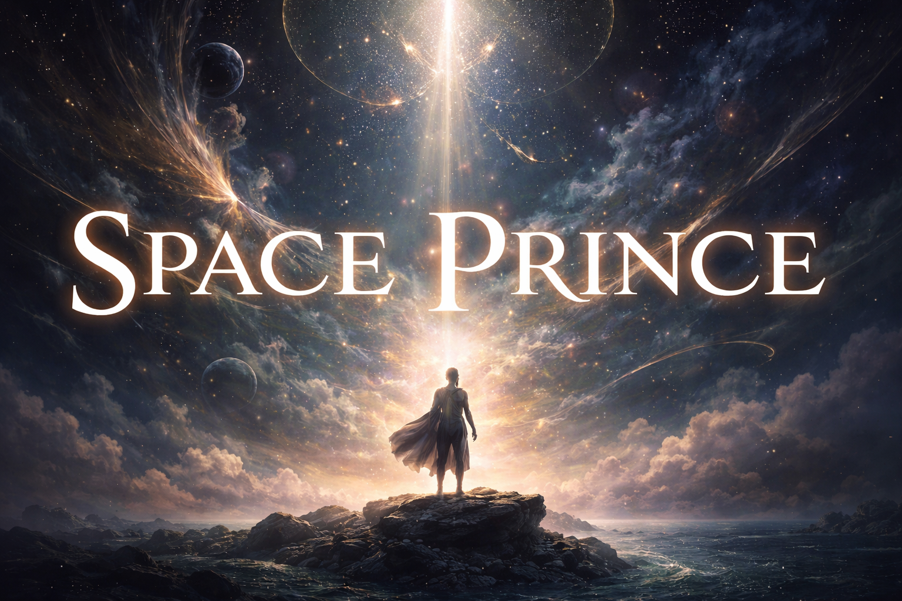

# Space Prince

Space Prince is an onchain roguelike about identity, attention, and irreversible choice.

Players mint a globally unique **Prince**, defined by a latitude, longitude, and timestamp.
That position determines an astrological natal chart: 7 planets, each placed in a sign and a house.
The chart is the character sheet, the save file, and the artifact, all the same object.

Play is a journey of encounters.
When two charts meet, each turn the player chooses which planet to send and whether it afflicts or testifies; the effect lands on the other chart and travels along that chart's own aspects.
Every such encounter has a ruler, the planet ruling the other chart's rising sign, and the ruler decides what earns **Light**.
In the houses of the player's own chart, each scene asks for one choice about the chart they carry onward.
Affliction accumulates, planets combust and return, and runs end.
Over a lifetime of encounters the chart fills in, one planet at a time, and every run leaves one star in the Prince's sky, shaped by the Light it carried out.

---

## Status

Two things live in this repository, at different stages.

- **The client** (`client/`) is a local prototype: React, Vite, and TypeScript, rendering everything as SVG.
  It has no wallet, no RPC, and no contract calls.
  Charts come from a real ephemeris, state lives in `localStorage`, and the focus is combat flow and chart legibility.
- **The onchain game** (`cairo/`) is the ambition: chart derivation, game state, resolution, and the Prince NFT computed on Starknet, with astronomy supplied by the separate [`astronomy-engine`](https://github.com/kronosapiens/astronomy-engine) package.
  The chart-derivation crate exists; the game contracts do not yet.

The public landing page lives in `landing/` ([spaceprince.xyz](https://spaceprince.xyz)).

## Reading

- [docs/intent.md](docs/intent.md): premise, audience, the desired experience, and influences.
- [docs/README.md](docs/README.md): the map of the design references, with reading paths for mechanics, presentation, writing, and onchain work.
- [client/README.md](client/README.md): how the prototype is wired.

---

## What This Is

- A **fully onchain** game by design; the client is presentation only
- A **single-player** roguelike where play accrues into a permanent record
- A **generative NFT** that evolves as a record of play
- An **art game** grounded in Hellenistic astrology

Progress does not increase power.
It increases specificity.

---

## Core Ideas

- **Identity is irreversible.**
  Minting recognizes a position; it does not create one.

- **Encounters are the action.**
  Each turn, who you send and how; in each house, one choice.
  Everything else emerges from chart structure.

- **The chart is the economy.**
  No HP, gold, energy, or inventory.
  A run holds seven affliction values, a few stat gains that last the run, and the Light gathered.
  Affliction builds tension, testimony relieves it, combustion silences; Light is what remains.

- **Aspects propagate with polarity.**
  Internal aspects carry effects between planets: trines and sextiles transmit, squares and oppositions invert, conjunctions fuse.
  A chart full of squares is harder to play and rewards mastery.

- **Failure is canonical.**
  A run ends in combustion as readily as in completion; either way, the world records the Light that remains.
  The chart was always complete.
  The player is catching up.

---

## The Prince NFT

The Prince NFT is the character, the save file, and the artifact.

It evolves deterministically from onchain state:
- **Early:** the Moon alone, the other six planets as ghosts
- **Mid:** planets arriving one at a time as lifetime encounters accumulate, aspect lines connecting them
- **Late:** the full wheel, with a sky above it holding one star per run

Two Princes are distinguished not by rarity traits but by lived history.

---

## What This Is Not

- A TCG
- A hero collector
- A loot treadmill
- A competitive ladder
- A belief-driven astrology simulator
- A free-to-play engagement machine

It is not trying to entertain.
It is trying to reward attention.
